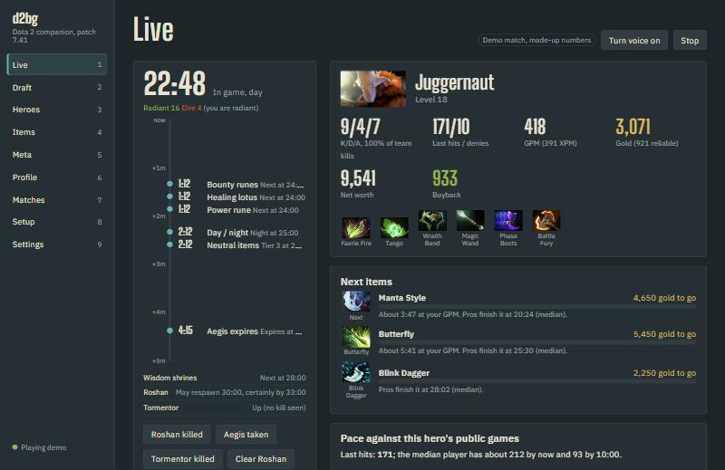
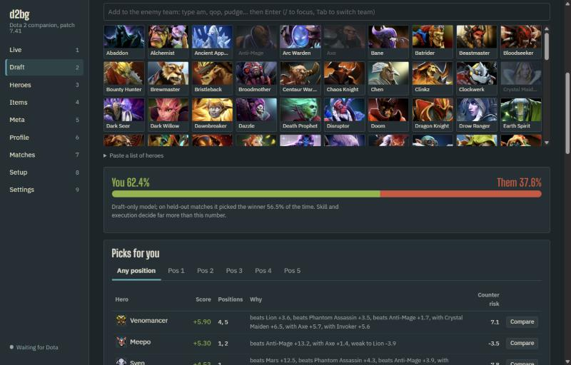

# dota2-build-generator

A Dota 2 companion that runs on your own PC: draft advice, pro builds, live timers and a post-game
review. It listens only to what Dota 2 sends through Valve's **Game State Integration** and reads
**public APIs**, so it never touches the game process. See [docs/SAFETY.md](docs/SAFETY.md).



## Measured results

| What | Result | How it was measured |
|---|---|---|
| Draft win model | **56.55% accuracy**, AUC 0.585, log loss 0.678 on 7,015 held-out matches | Logistic regression on hero picks plus out-of-fold matchup features. The newest 20% of 35,074 ranked All Pick matches (by match ID) were held out. Baseline that always picks the side that won more often in training: 54.35%, log loss 0.690. Hero picks alone: 56.44%. `data/snapshot/draft_model.json` |
| Live engine | p50 **0.34 ms**, p95 0.65 ms per GSI update | `bench/latency.py`: 2,526 synthetic payloads, in process, on this PC (Windows 11, Core i5-13600KF, 32 GB). `reports/latency.json` |
| GSI round trip | p50 **1.7 ms**, p95 2.3 ms | The same payloads POSTed to `/gsi` over loopback HTTP, token check included |
| Draft analysis | p50 **4.3 ms**, p95 6.2 ms | 300 random drafts with 0 to 5 heroes a side |
| Tests | 161 Python tests (94% line coverage), 6 Vitest, 6 Playwright end-to-end, 21 v1 tests | All run in CI on every push |
| Data snapshot | 127 heroes, 409 items, 35,074 ranked matches, 2,306 pro matches (22,687 hero-games) since 2026-06-21, patch 7.41 | `data/snapshot/manifest.json` |
| Full data refresh | about 650 OpenDota requests (the free limit is about 3,000 a day) | Measured on 2026-10-19 |
| UI bundle | 113 KB of JavaScript and 4 KB of CSS, gzipped | `npm run build` |

The 35,074 public matches all started in one 2.5-hour window (2026-10-16 21:59 to 2026-10-17 00:32
UTC). Each `d2bg data refresh` adds roughly as many again, and the matchup matrix keeps a rolling 14
days, so the sample grows if you refresh every day.

## Run it on Windows

You need [uv](https://docs.astral.sh/uv/) (`winget install astral-sh.uv`) and Node.js 20 or newer
(only to build the UI the first time). Then:

```bash
.\run.cmd
```

It installs the Python packages, builds the UI if needed, starts the app on
<http://127.0.0.1:4242> and opens your browser. `Ctrl+C` stops it.

First time with Dota:

1. On the **Setup** page, click **Install**. This writes one file,
   `game\dota\cfg\gamestate_integration\gamestate_integration_d2bg.cfg`, into your Dota folder.
2. Start Dota 2. Setup turns green when the first update arrives.
3. If nothing arrives within a minute, add `-gamestateintegration` to Dota's launch options in Steam
   yourself. The app never edits your launch options.

Without Dota, click **Play a demo match** on the Live page, or run `.\run.cmd --demo juggernaut`. The
demo is a made-up match and the page says so.

On a second screen or a phone, open `/compact`, or start with `.\run.cmd --lan`, which prints the
address with an access token. For an always-on-top window over a borderless Dota, run
`uv sync --extra window` once, then `uv run d2bg window`. It is an ordinary separate window and
draws nothing inside the game.

## What it does

| Page | What you get |
|---|---|
| **Live** | A game-clock rail with the next five minutes of runes, wisdom shrines, lotus, Tormentor, neutral tiers and the Roshan respawn window, each citing its patch note. Your K/D/A, last hits, GPM, gold and buyback. Next items with gold still needed after the parts you own, time to afford at your GPM, and the pro median. Skill-point reminders, a buyback guard, pace against the hero's percentiles, items to buy against the enemy draft, and alerts read aloud if you want. |
| **Draft** | A Radiant and Dire board you fill by keyboard (`am`, `qop`, `wr` work; Enter adds, Tab switches team). Picks overall and per position, each with the matchups behind its score. Bans, counters to each enemy, a win estimate, lanes, team gaps such as "no stun or hex", and items to plan for. |
| **Heroes** | Pro skill order and talents, starting items, the item order with median timings, win rate by item timing, matchups by rank bracket, similar heroes, benchmarks, positions, abilities. |
| **Items** | Cost, recipe, components, what it builds into, and which pro heroes build it and when. |
| **Meta** | Tiers by medal (Herald to Immortal) from public games, plus pro (with bans) and Turbo. |
| **Profile** | Rank, win rate, streaks, sessions, win rate by hour, hero pool with a 95% lower-bound win rate, heroes worth adding, players you queue with. Look up anyone. |
| **Matches** | Any match OpenDota has: scoreboard, your percentiles for the hero, your item timings against pro medians. After each game it fetches the match by itself. |
| **Setup** | Install or remove the GSI config, see the connection, refresh data with a request budget, replay recorded games. |

All 85 built features, the 13 planned ones and the 10 rejected for safety are listed in
[docs/ROADMAP.md](docs/ROADMAP.md). The design decisions are in [docs/DESIGN.md](docs/DESIGN.md).



## Ban safety, in short

| The app touches | How |
|---|---|
| One GSI config file in the Dota folder | Written when you click Install, deleted when you click Remove |
| Steam's `libraryfolders.vdf` and the `SteamPath` registry value | Read only, to find Dota |
| `127.0.0.1:4242` | Dota posts game state here; your browser loads the UI |
| `api.opendota.com` | Public API, about one request a second at most, cached on disk |

It never reads or writes game memory, injects anything, draws inside the game, sends keystrokes or
clicks, captures the screen or network, or edits game files or Steam settings.
`tests/d2bg/test_safety.py` enforces this in CI. The reasoning, with Valve's 2023 ban-wave statement, is in
[docs/SAFETY.md](docs/SAFETY.md).

## How it works

```
Dota 2 ──GSI POST──▶ /gsi ──▶ parser ──▶ live engine ──SSE──▶ browser UI
                       └──▶ recorder (gzip JSONL, replayable)
OpenDota API ◀── rate-limited, caching client ◀── refresh pipeline and profile and match lookups
data/snapshot (committed) + refreshed data ──▶ draft, builds, traits, timers (pure functions) ──▶ FastAPI ──▶ UI
```

- **Python 3.12**: FastAPI, Pydantic, httpx, Typer. mypy strict, ruff.
- **UI**: React 19, TypeScript (strict), Vite, TanStack Query, self-hosted fonts so it works offline.
- **Models**: scikit-learn for training only; the draft model ships as JSON weights and runs in plain
  Python. No pickles.

| Data | Source |
|---|---|
| Heroes, items, abilities, talents | OpenDota `/constants` (dotaconstants, MIT) |
| Win rates by medal, pro picks and bans | `/heroStats` |
| Hero vs and with advantage per rank bucket | `/publicMatches`, ranked All Pick, our smoothing |
| Skill orders, talents, item orders and timings, positions | `/explorer` over parsed pro matches |
| Item popularity, benchmarks, item-timing and lane win rates | `/heroes/{id}/itemPopularity`, `/benchmarks`, `/scenarios/*` |
| Your profile and matches | `/players/*`, `/matches/*` |
| Timer rules | Valve's patch notes feed, cited per rule in `data/knowledge/timers-7.41.json` |

## Command line

```bash
uv run d2bg serve                 # the app (what run.cmd starts)
uv run d2bg draft --enemy "pa, lion, invoker" --ally "cm, axe"
uv run d2bg build invoker         # pro build as text
uv run d2bg data refresh          # about 650 OpenDota requests
uv run d2bg data status
uv run d2bg gsi status            # also: gsi install, gsi remove
uv run --extra train d2bg train   # retrain the draft model
```

## Development

```bash
make install    # uv sync --extra dev, npm ci
make check      # ruff, mypy, pytest, eslint, tsc, vitest, Playwright
uv run python bench/latency.py
```

CI runs four jobs: Python (ruff, mypy, pytest with coverage), UI (eslint, tsc, Vitest, build),
Playwright against the real server and demo match, and the v1 desktop app's tests.

## Limitations

1. **Ranked drafts are typed in by hand.** Dota sends players no enemy picks through GSI; only
   spectators get the full draft.
2. **The draft model is modest.** It beats the baseline by 2.2 points of accuracy, and the matchup
   features add only 0.1 point over hero picks alone. Treat the win estimate as a tilt, not a verdict.
3. **Builds come from pro games.** Some heroes have few pro games; pages say so when it is under 20.
4. **Positions and hero traits are heuristics**: positions from lane and GPM in pro games, traits from
   ability text, with a small reviewed override file. Both show their evidence.
5. **Timers** are checked against patch notes up to 7.41f. Aegis (5 minutes) and day/night (5 minutes)
   are long-standing mechanics not restated in recent notes; the day/night timer corrects itself
   from the game's own day flag.
6. **Talent numbers**: Valve's public text leaves many values out; those show as X.
7. **The skill-point reminder is an estimate**; innate abilities can make it miss a point.
8. **The always-on-top window** (`d2bg window`) has not been tested here.

## The v1 desktop app

The original Tk app is still here (`main.py`, `logic/`, `ml/`, `ui/`), unchanged. Its hero data
files were never committed, so it runs on fallbacks. Run it with `pip install -r requirements.txt`
and `python main.py`. Its tests run in CI.

## License

MIT. Game data from OpenDota (dotaconstants is MIT). Hero and item images load from Valve's CDN. Dota 2
is a trademark of Valve Corporation; this project is not affiliated with Valve or OpenDota.
